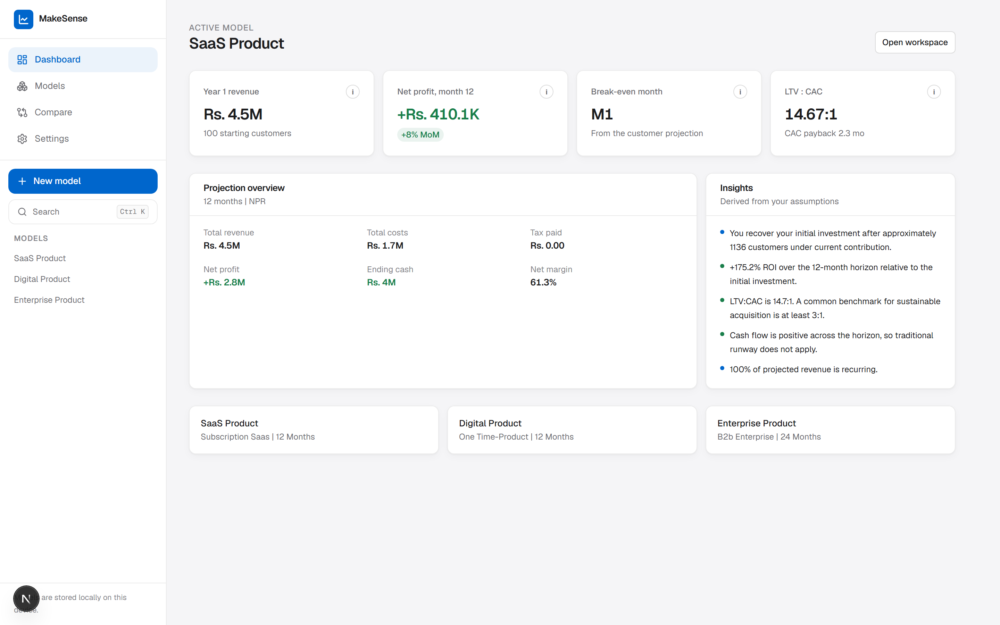
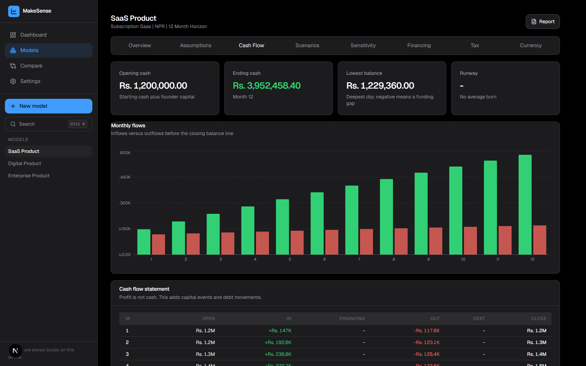
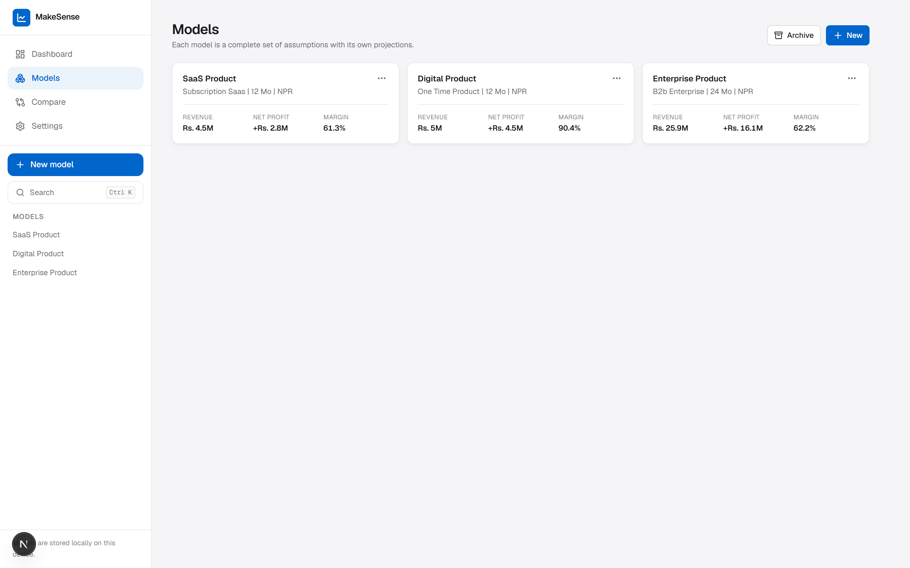
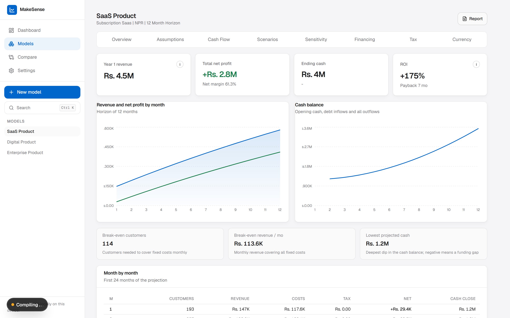
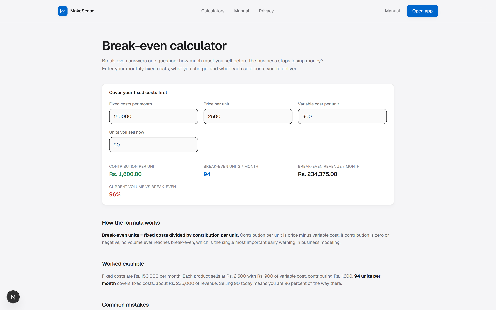

@AGENTS.md

what we were doing : check git for the files you were modifying, and read md files for more info, read the whole repo before starting anything.

what to do more:
i can see em dashes in landing page i hope you will remove it, this "Free · No sign-up · Works offline" chip design is pure ai looking remove it, add current active page+hover interactions in header in landing page, "makesense — dashboard" this is just not working or something its just showing text that says "the makesense dashboard ...." and we need a ton of animations in landing page i suggest redesigning it with unique looks according to our product aesthetics, and footer is clean but you could add something more also my socials in the footer . and some nice scroll text animations in text heavy places like user manual, and other pages. we need animations without making it laggy or heavy for devices , but subtle animations says a lot about your product so we need enhancing. also the section that opens when we click "open app" that whole section is not showing our custom cursor it just shows invisible or no cursor so look into it. and i hope you are doing meaningful commits regularly.

your last response before token limit was :
`
Edit README.md
MakeSense is a business model simulator for entrepreneurs. Turn a business idea into a mathematical model and understand the economics before spending significant time or money building it. Model revenue, costs, customers, tax, currency, financing, and scenarios in one coherent system, entirely on your own device.

Live: https://makesensebusiness.vercel.app/

## Screenshots

**Dashboard** — every model's year-one revenue, margin, runway and generated insights in one glance.

**Cash flow workspace (dark theme)** — month-by-month inflows, outflows and running balance with loan schedules.

**Model gallery** — templates and saved models with summary metrics.

**Printable report** — a share-ready document generated from the model.

**Standalone calculators** — twelve free calculators with formulas explained.

## What it does

- Model any business: digital products, SaaS, consulting, e-commerce, marketplaces, enterprise deals, or hybrids.
- Calculate revenue, profit, margins, break-even, ROI, payback, unit economics, CAC, LTV, MRR, ARR, cash flow, and runway from one canonical model.

`
