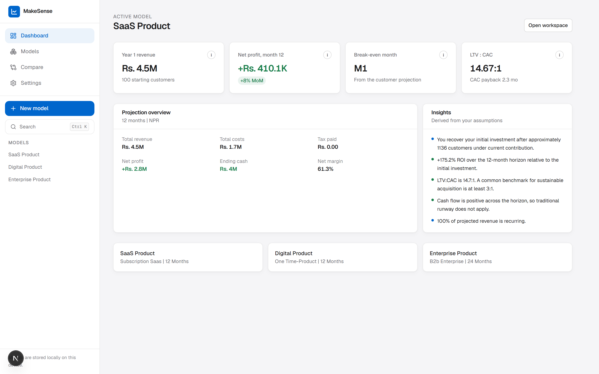
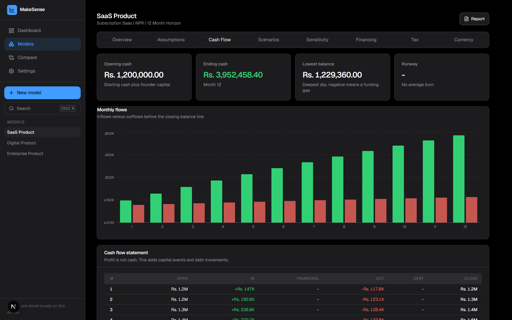
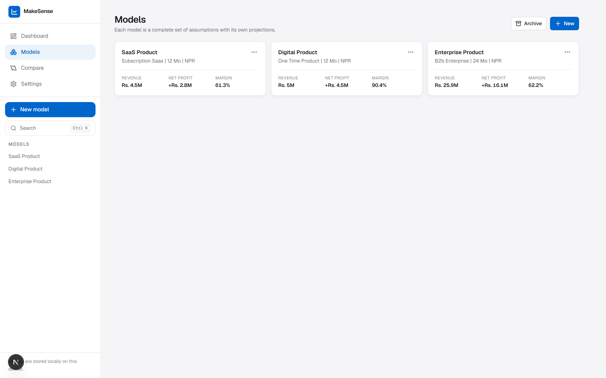
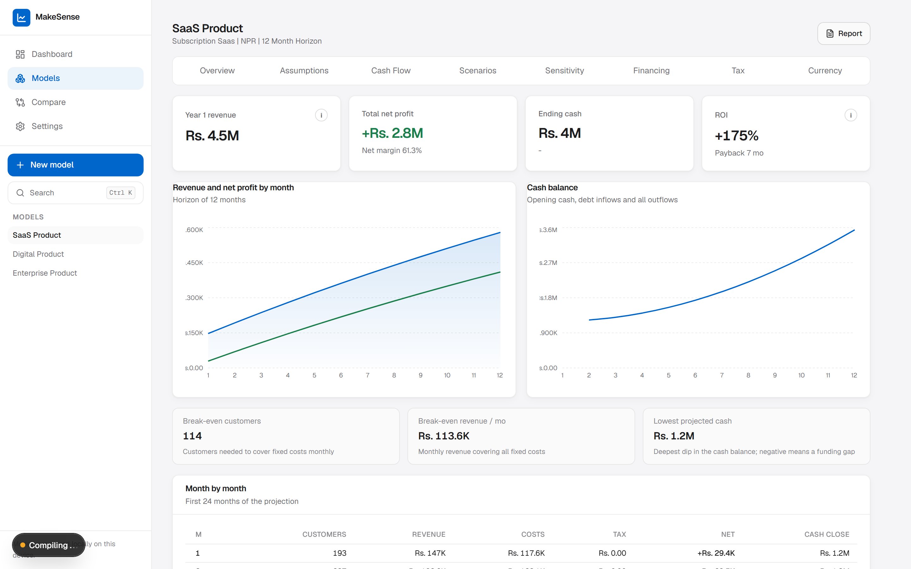
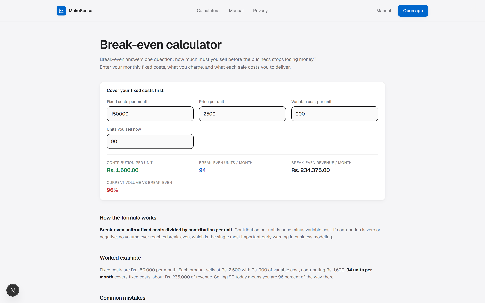

# MakeSense

**Make your money make sense.**

MakeSense is a local-first financial toolkit with two layers:

- **Business calculators and a full model simulator** - model revenue, costs,
  tax, currency, financing, and scenarios for any business idea. Understand the
  economics before spending real time or money building it.
- **Personal finance calculators** - quick, honest answers for everyday money
  questions: what you really earn, how long it takes to reach a savings goal,
  where your income goes, and how much to set aside for emergencies.

Everything runs entirely on your device via IndexedDB. No account, no uploads,
no tracking.

Live: https://makesensebusiness.vercel.app/

## Screenshots



**Dashboard**: every model's year-one revenue, margin, runway and generated insights in one glance.


**Cash flow workspace (dark theme)**: month-by-month inflows, outflows and running balance with loan schedules.



**Model gallery**: templates and saved models with summary metrics.



**Printable report**: a share-ready document generated from the model.



**Standalone calculators**: free calculators with formulas explained.

## Public site

- **Twelve business calculators** (`/calculators`): break-even, profit margin,
  revenue projection, ROI, pricing, cash flow, startup runway, SaaS metrics,
  LTV:CAC, corporate tax, VAT/GST, and a full profitability snapshot. Each page
  has a live widget, the exact formula, a worked example, common mistakes, and
  FAQs.
- **Four personal finance calculators** (`/personal-finance`): salary
  conversion, savings goal, income vs expenses, and emergency fund, built with
  the same formula-and-example standard.
- **Guides** (`/guides`): plain-language articles that walk through runway,
  revenue estimation, and LTV:CAC with worked examples.
- **SEO/AEO/GEO ready**: unique metadata per page, JSON-LD structured data
  (WebApplication, HowTo, FAQPage, BreadcrumbList, ItemList, DefinedTermSet,
  Article), sitemap, AI-crawler robots rules, and an `llms.txt` index for
  answer and generative engines.

## What the app does

- Model any business: digital products, SaaS, consulting, e-commerce,
  marketplaces, enterprise deals, or hybrids.
- Calculate revenue, profit, margins, break-even, ROI, payback, unit economics,
  CAC, LTV, MRR, ARR, cash flow, and runway from one canonical model.
- Test pricing, simulate conservative to aggressive scenarios, stress-test
  assumptions with sensitivity tables.
- Plan tax with jurisdiction-aware profiles including VAT/GST.
- Compare alternative business models side by side with factual observations.
- Export a printable report or versioned JSON of every model.
- Install as a PWA: works offline, with Home Screen shortcuts.

The calculation engine uses decimal arithmetic end to end. Every key metric
exposes the assumptions and formula behind it. Results are transparent
mathematics under your assumptions, never predictions.

## Tech stack

Next.js (App Router), React, TypeScript, Tailwind CSS 4, shadcn/ui-style
components on Radix primitives, Motion, Zustand, Recharts, decimal.js, Dexie
(IndexedDB), Zod, Vitest, Playwright.

## Getting started

Requirements: Node.js 20 or newer, npm (pnpm works too).

```bash
npm install
npm run dev
```

Open http://localhost:3000.

Other scripts:

```bash
npm run build        # production build
npm run lint         # eslint
npm run typecheck    # tsc --noEmit
npm test             # vitest domain tests
```

## Project structure

| Path | Purpose |
|---|---|
| `src/lib/` | Domain engine, calculator and directory registries |
| `src/components/calculators/widgets/` | Interactive calculator widgets |
| `src/app/calculators/` + `src/app/personal-finance/` | Calculator landing pages |
| `src/app/guides/` + `src/components/guides/` | Educational articles |
| `src/components/site/` | Header, footer, install button, document pages |
| `src/components/workspace/` | The app's workspace tabs |
| `docs/` | FDS, implementation plan, build tracker |

## Documentation

| Document | Contents |
|---|---|
| docs/FDS.md | Functional design specification |
| docs/IMPLEMENTATION_PLAN.md | Build order and verification gates |
| docs/TRACKER.md | Live build status per feature |
| FEATURES.md | All features with short descriptions |
| CHANGELOG.md | Notable changes over time |
| CONTRIBUTING.md | How to contribute and the verification gates |

## Privacy

Local first by design. Business models and financial inputs are stored in your
browser via IndexedDB and never leave your device. No account required.

## Security

See SECURITY.md for how to report vulnerabilities. Financial data stays in the
browser; there is no backend to breach.

## Disclaimer

MakeSense provides financial modeling and tax-planning estimates for
informational purposes. Tax rules, exchange rates, and financial outcomes
depend on jurisdiction, timing, assumptions, and individual circumstances. It
is not legal, tax, accounting, or investment advice.

## License

All rights reserved. Copyright (c) 2026 Arun Neupane. Use of this software
requires prior written permission from the author. See LICENSE.

## Author

Arun Neupane, Butwal, Nepal. https://arunneupane.vercel.app